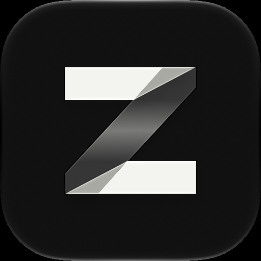

<h1 align="center">Zero Enclave</h1>

<strong>Private by design.</strong> 
Encrypted photo and video vault for iPhone. Local only: no account, no server, no tracking.

<a href="https://zeroenclave.com">zeroenclave.com</a> · <a href="https://apps.apple.com/app/id6832976447">App Store</a>

---

Argon2id, HKDF-SHA256 and AES-256-GCM in a Rust core. This repository receives one commit per App Store release, matching the code of that build.

| Path | Content |
|---|---|
| `core/` | Rust crate `zeroenclave-core` |
| `bindings/` | UniFFI bindings, XCFramework for Swift |
| `apple/` | SwiftUI app for iPhone |
| `test-vectors/` | cross-platform test vectors |

- **Security:** report vulnerabilities privately, see [SECURITY.md](SECURITY.md).
- **Contributing:** issues are welcome, pull requests are not accepted for now, see [CONTRIBUTING.md](CONTRIBUTING.md).
- **License:** [GNU GPL v3.0](LICENSE). The name "Zero Enclave", the app icon and the files in `assets/logo/` are not covered by this license and may not be used for derived works.
